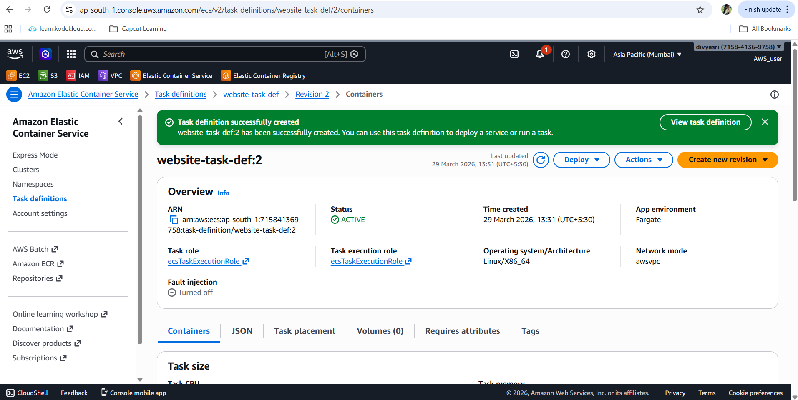
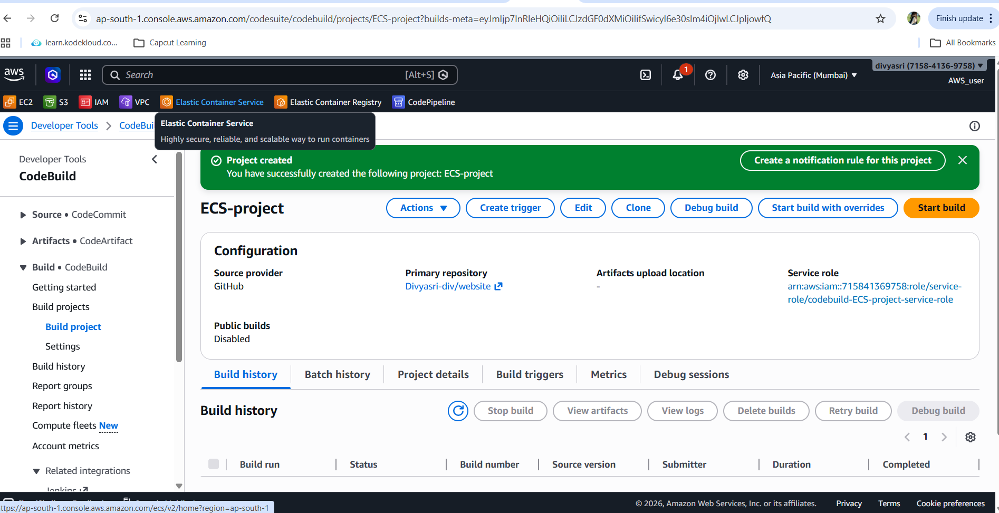
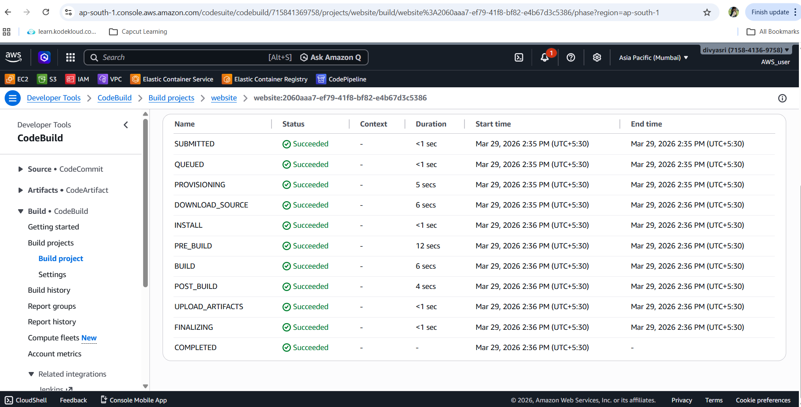
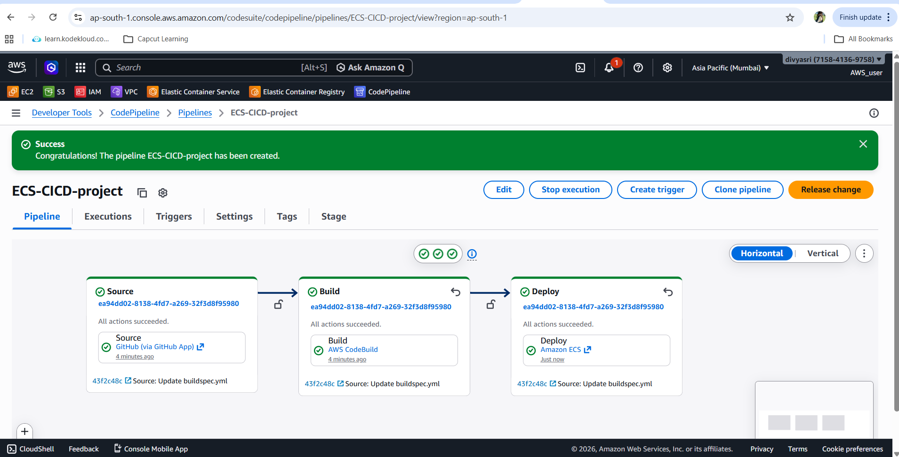

# 🚀 AWS ECS Fargate CI/CD Deployment (End-to-End)

## 📌 Overview

This project demonstrates how to deploy a containerized application on AWS using:

* **Amazon ECS (Fargate launch type)**
* **Amazon ECR**
* **AWS CodePipeline**
* **AWS CodeBuild**
* **Application Load Balancer**
* GitHub (source code)

---

## 🏗️ Architecture Flow

```
GitHub → CodePipeline → CodeBuild → ECR → ECS (Fargate) → ALB → User
```

---

## ⚙️ 1. Task Definition Setup

Create a Task Definition with the following configuration:

### General Settings

* **Family Name:** `website-task-df`
* **Launch Type:** Fargate
* **CPU:** 0.25 vCPU
* **Memory:** 0.5 GB

### Container Configuration

* **Container Name:** `website`
* **Image URI:**

  ```
  289857919920.dkr.ecr.ap-south-1.amazonaws.com/website:latest
  ```
* Enable **CloudWatch Logs**
* Keep other settings default

✅ Task Definition Created

<h3 align="left">task_def</h3>
<p align="left">
  
</p>

---

## ▶️ 2. Run Task (Testing Phase)

> This step is optional and used only for validation

* Navigate to **Cluster → Tasks → Run Task**
* Launch Type: Fargate
* Task Count: `2`

✅ Access application using **Public IP**

⚠️ Limitation:

* Public IP changes every time → Not suitable for users

---

## 🌐 3. ECS Service with Load Balancer

To provide a stable endpoint, create a **Service**.

### Configuration

* **Service Name:** `websiteservice`
* **Launch Type:** Fargate
* **Desired Tasks:** 2

### Networking

* Enable **Public IP**
* Attach **default security group**

### Load Balancer Setup

* Type: Application Load Balancer
* Target Type: IP
* Health Check Path: `/`

### Auto Scaling Policy

* Minimum Tasks: 2
* Maximum Tasks: 4
* Metric: CPU Utilization
* Target: 70%

✅ Service Created → Accessible via ALB DNS

<h3 align="left">access_service</h3>
<p align="left">
  
</p>

---
## 🔁 4. CodeBuild Setup

Create a build project in **AWS CodeBuild**

### Configuration

* **Project Name:** `website`
* **Source:** GitHub
* **Repository:**

  ```
https://github.com/Divyasri-div/website.git
  ```
* **Buildspec File:** `buildspec.yml`
* **Artifacts:** None

<h3 align="left">buildproject</h3>
<p align="left">
  
</p>


---

### 🔐 IAM Role Permissions

Attach the following policies:

* AmazonEC2ContainerRegistryFullAccess
* AmazonEC2ContainerRegistryPowerUser
* SecretsManagerReadWrite

---

### ▶️ Build Execution

* First build → ❌ fails (missing permissions)
* Add IAM permissions
* Second build → ✅ success

<h3 align="left">build_success</h3>
<p align="left">
  
</p>

➡️ Docker image pushed to **Amazon ECR**

---

## 🔄 5. CodePipeline Setup

Create pipeline in **AWS CodePipeline**

### Pipeline Details

* **Name:** `ECS-CICD`
* Execution Mode: Queued

---

### Source Stage

* Provider: GitHub v2
* Branch: `master`
* Trigger: Push events

---

### Build Stage

* Provider: CodeBuild
* Project: `website`

---

### Deploy Stage

* Provider: Amazon ECS
* Cluster: Your ECS Cluster
* Service: `websiteservice`
* Image File:

  ```
  imagedefinitions.json
  ```
<h3 align="left">pipeline</h3>
<p align="left">
  
</p>
---

## 🚀 CI/CD Workflow

1. Developer pushes code to GitHub
2. CodePipeline triggers automatically
3. CodeBuild builds Docker image
4. Image pushed to ECR
5. ECS Service updates automatically
6. ALB serves updated application

---

## 🧪 Testing the Pipeline

* Modify `index.html` in GitHub
* Push changes

✅ Pipeline runs automatically
✅ Website updates without manual intervention

