# Jenkins Installation and Configuration on AWS EC2 (Amazon Linux 2)

This repository documents my hands-on setup of **Jenkins** on an **Amazon Linux 2 EC2 instance** as part of my DevOps learning journey.  
This documentation provides a detailed step-by-step guide to installing and configuring **Jenkins** on an **AWS EC2** instance running **Amazon Linux 2**.  
Jenkins is an open-source automation server widely used for building CI/CD pipelines and automating software development workflows.

---

## 🧠 Project Overview

This project demonstrates how to:
- Launch an EC2 instance on AWS
- Install and configure **Java 17 (Amazon Corretto)**
- Install and run **Jenkins** as a service
- Access Jenkins from the public IP

---

## ☁️ 1. Launch EC2 Instance

### EC2 Configuration:

- **AMI:** Amazon Linux 2 (Free Tier eligible)
- **Instance Type:** t2.medium
- **Key Pair:** Existing or newly created `.pem` key
- **Storage:** Default (8 GB or more)
- **Security Group Inbound Rules:**
  | Type | Protocol | Port | Source |
  |------|-----------|------|---------|
  | SSH | TCP | 22 | My IP |
  | HTTP | TCP | 80 | Anywhere |
  | Custom TCP | TCP | 8080 | Anywhere |

> Port 8080 is required for Jenkins UI access.


<h3 align="left">ec2-setup</h3>
<p align="left">
  
</p>


<h3 align="left">ec2-setupp</h3>
<p align="left">
  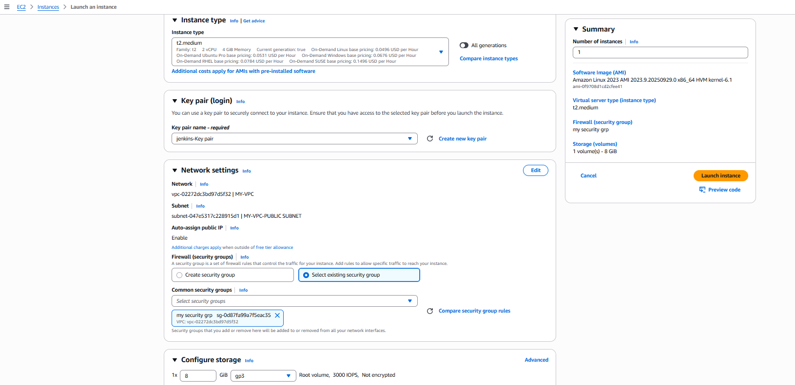
</p>


<h3 align="left">security grp-rules</h3>
<p align="left">
  
</p>


## 🔗 2. Connect to EC2 Instance

Use your terminal to connect via SSH:

```bash
ssh -i <your-key.pem> ec2-user@<your-ec2-public-ip>
```
Example:

```bash
ssh -i mykey.pem ec2-user@13.233.xxx.xxx
```


<h3 align="left">ssh-connectionn</h3>
<p align="left">
  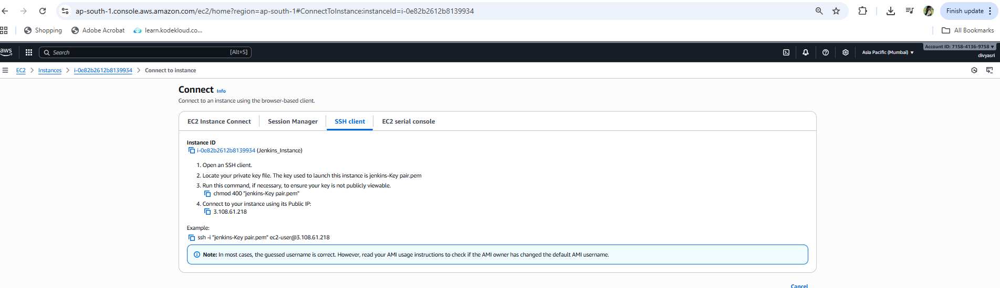
</p>


<h3 align="left">ssh-connection</h3>
<p align="left">
  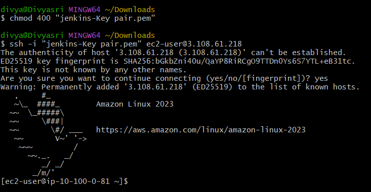
</p>

## ☕ 3. Install Java (Amazon Corretto 17)

Jenkins requires Java 17 or higher to run.
Since Jenkins is built on Java, it depends on a Java Runtime Environment (JRE) or Java Development Kit (JDK) to function — without Java, Jenkins cannot start.

To install the recommended version, use Amazon Corretto 17, a secure and optimized OpenJDK distribution maintained by AWS:

```bash
sudo yum update -y
sudo yum install java-17-amazon-corretto -y
```


<h3 align="left">java-installation</h3>
<p align="left">
  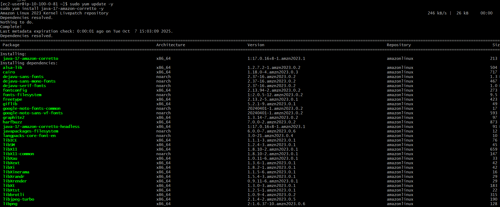
</p>


## 4. Verify Installation

After installation, verify the version again:

```bash
java -version
```
You should see an output like this:

openjdk version "17.0.11" 2024-04-16 LTS
OpenJDK Runtime Environment Corretto-17.0.11.9.1 (build 17.0.11+9-LTS)
OpenJDK 64-Bit Server VM Corretto-17.0.11.9.1 (build 17.0.11+9-LTS, mixed mode, sharing)

<h3 align="left">java-version</h3>
<p align="left">
  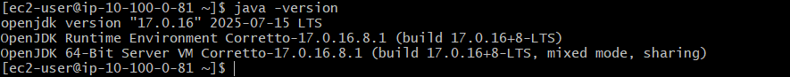
</p>


## ⚙️ 5. Install Jenkins

Jenkins is not included in the default Amazon Linux 2 repositories, so you’ll need to add the official Jenkins repository and import its GPG key before installation.

Add the Jenkins repository and import its key:

sudo wget -O /etc/yum.repos.d/jenkins.repo \
https://pkg.jenkins.io/redhat-stable/jenkins.repo

sudo rpm --import https://pkg.jenkins.io/redhat-stable/jenkins.io-2023.key

-The first command downloads the Jenkins repo file into your system’s repository directory.

-The second command imports the GPG key used to verify Jenkins packages, ensuring they haven’t been tampered with.


Install Jenkins:

```bash
sudo yum install jenkins -y
```

<h3 align="left">jenkins-install</h3>
<p align="left">
  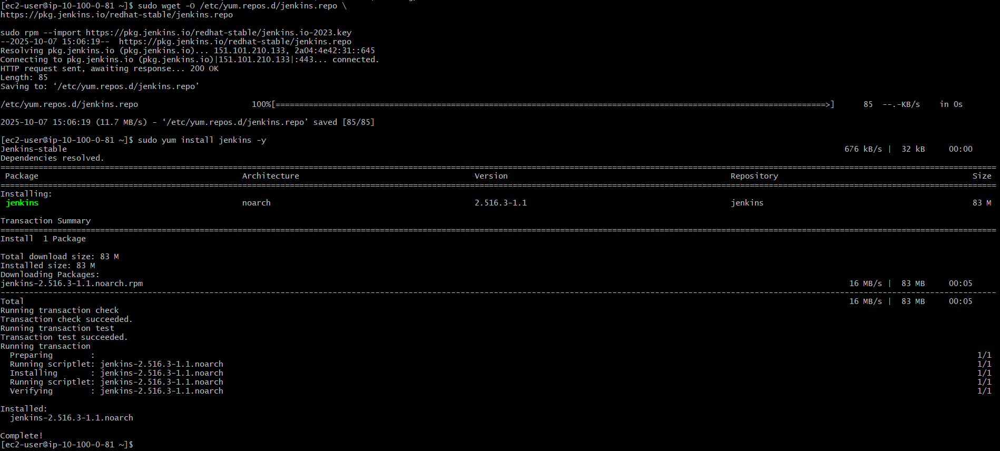
</p>


## 🚀 6. Start and Enable Jenkins

Start and enable the Jenkins service:

```bash
sudo systemctl enable jenkins
sudo systemctl start jenkins
sudo systemctl status jenkins
```

If successful, you’ll see:

Active: active (running)

<h3 align="left">jenkins-active</h3>
<p align="left">
  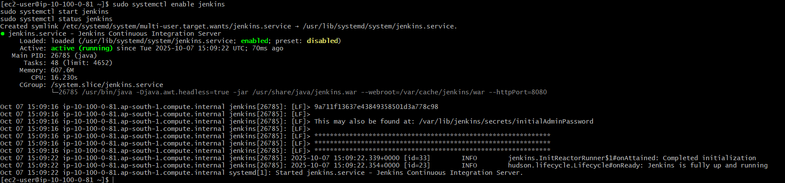
</p>


## 🌐 7. Access Jenkins in Browser

Open your browser and navigate to:


http://<your-ec2-public-ip>:8080


Example:

http://13.233.xxx.xxx:8080


<h3 align="left">unlock-jenkins</h3>
<p align="left">
  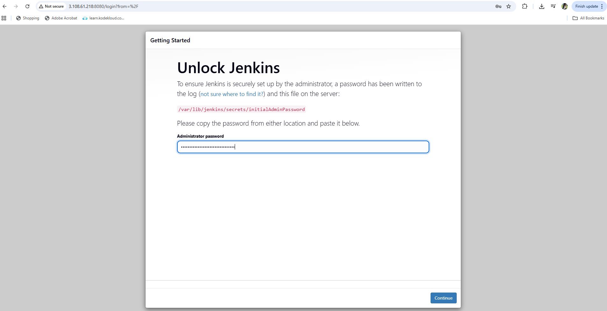
</p>

## 🔑 8. Unlock Jenkins

Get your initial admin password:

sudo cat /var/lib/jenkins/secrets/initialAdminPassword


Copy the password and paste it into the Jenkins setup wizard.

Then:

Click “Install Suggested Plugins”

Create an Admin User

Set Jenkins URL to:

http://<your-ec2-public-ip>:8080/

<h3 align="left">jenkins-unlock</h3>
<p align="left">
  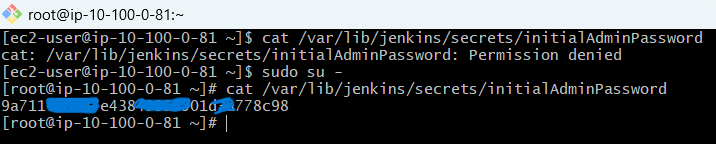
</p>

<h3 align="left">jenkins-plugin</h3>
<p align="left">
  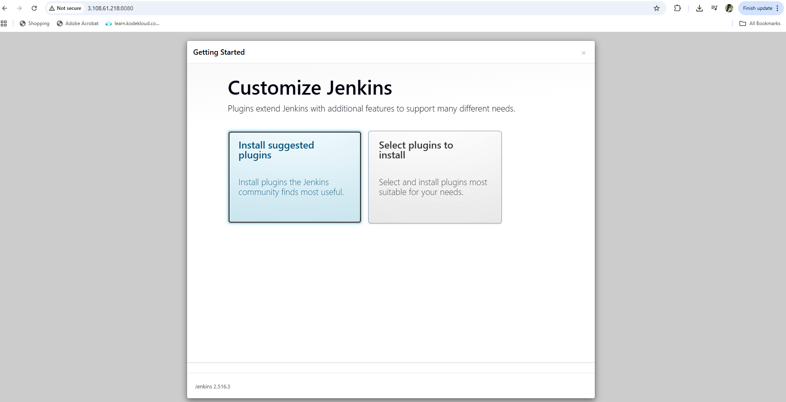
</p>

<h3 align="left">jenkins-getting started</h3>
<p align="left">
  
</p>


<h3 align="left">jenkins-ready</h3>
<p align="left">
  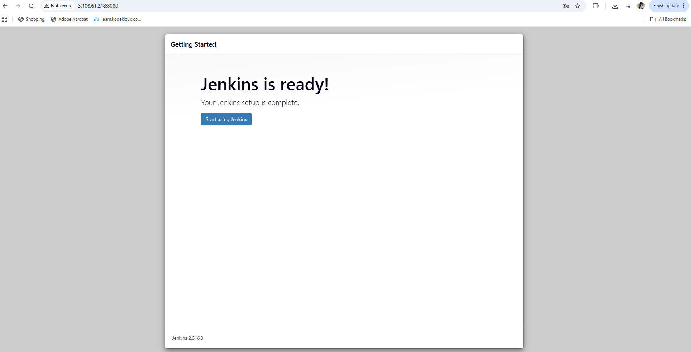
</p>

## ✅ 9. Verification

Access Jenkins dashboard:

http://<your-ec2-public-ip>:8080

<h3 align="left">jenkins-dashboard</h3>
<p align="left">
  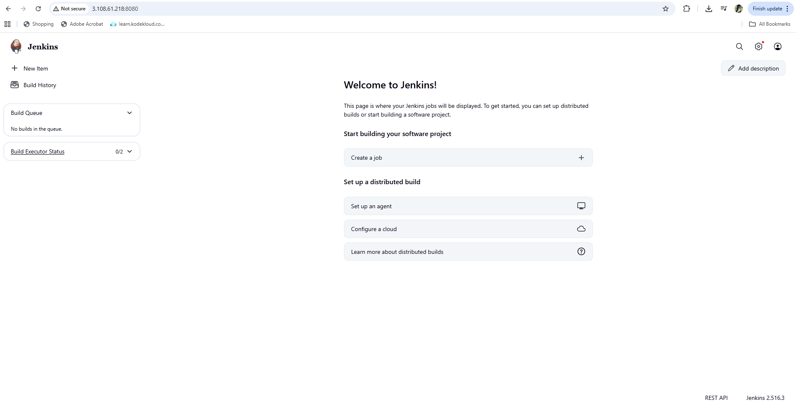
</p>

