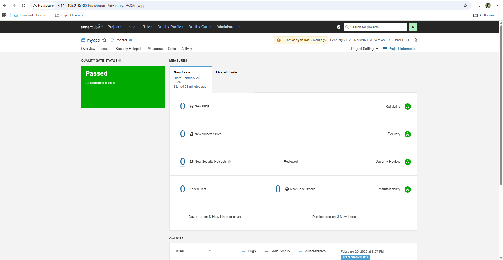
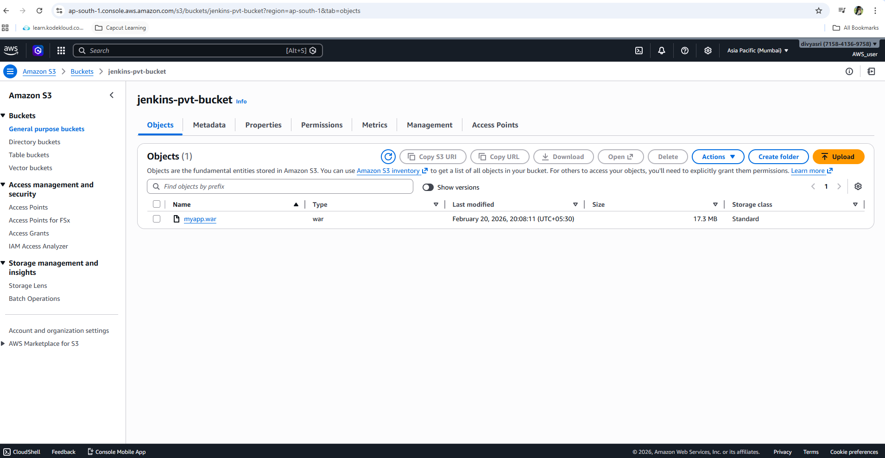
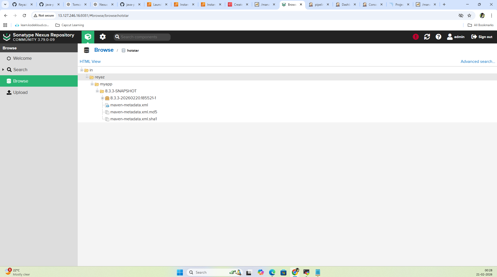
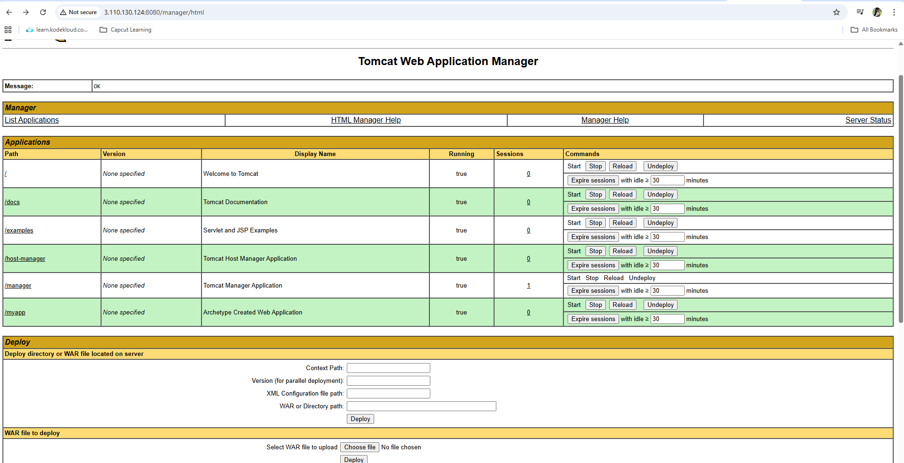
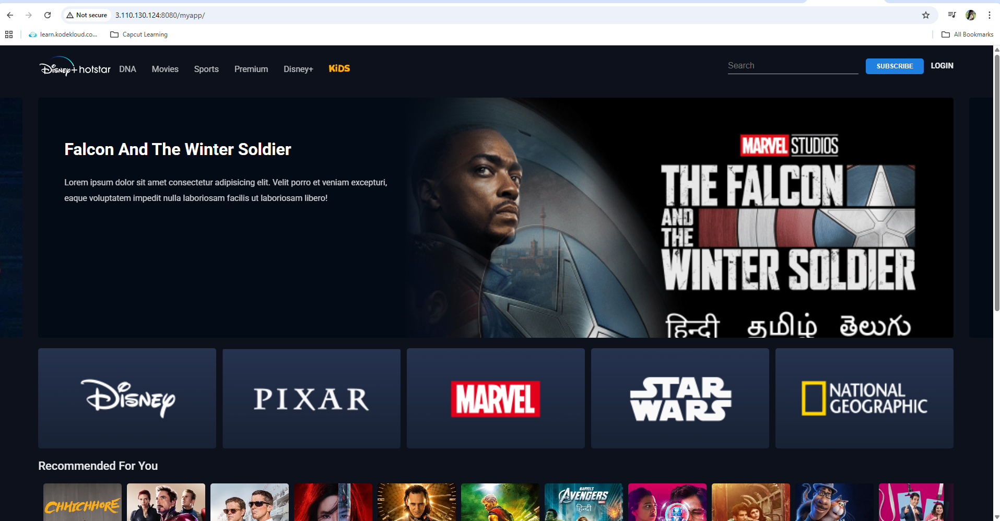

## 🚀 End-to-End CI/CD Pipeline for Java Web Application

End-to-End Continuous Integration & Continuous Deployment using Jenkins and AWS

## 📌 Project Overview

This project demonstrates the implementation of a production-style CI/CD pipeline for a Java-based Maven web application deployed on AWS infrastructure.

# The pipeline automates:

- Source Code Integration

- Build & Unit Testing

- Static Code Quality Analysis

- Artifact Versioning

- Cloud Artifact Backup

- Automated Deployment to Application Server

The entire workflow is implemented using a Jenkins Declarative Pipeline to simulate real-world enterprise DevOps practices.

## 🛠️ Technology Stack

#🔹 Application Layer

- Java

- JSP / Servlet

- HTML / CSS

- Maven

#🔹 DevOps & Infrastructure

-🔁 Jenkins – CI/CD Orchestration

-☕ Apache Maven – Build & Dependency Management

-🔍 SonarQube – Static Code Analysis

-📦 Nexus Repository – Artifact Repository

-🌐 Apache Tomcat – Application Deployment

-☁️ Amazon S3 – Artifact Backup

-🧑‍💻 GitHub – Source Code Management

-🖥️ AWS EC2 – Infrastructure Hosting

## 🏗️ Architecture Workflow

Developer Push → GitHub →
Jenkins Pipeline →
Build → Test → SonarQube Analysis →
Package (.war) →
Upload to S3 →
Upload to Nexus →
Deploy to Tomcat →
Application Live

#🔄 Jenkins Pipeline Stages

The pipeline is implemented using a Declarative Jenkinsfile and includes:

#1. Source Code Checkout

- Pulls code from GitHub repository.

#2. Build Stage

```
mvn compile
```
- Compiles source code.
- Resolves dependencies.

#3. Test stage 

```
mvn Test
```
- Executes automated unit tests. 

#4. Code Quality Analysis

- Performs static code analysis using SonarQube.

- Detects bugs, vulnerabilities, and code smells.

<h3 align="left">sonarqube</h3>
<p align="left">
  
</p>


#5. Package Stage
```
mvn Package
```
- Generates deployable .war file.

output:

```
target/myapp.war
```
#6. Upload Artifact to Amazon S3

- Uploads build artifact to S3 bucket.

- Provides secure cloud backup.


<h3 align="left">S3-bucket</h3>
<p align="left">
  
</p>


#7. Publish Artifact to Nexus

- Publishes versioned artifact to Nexus (Hosted Repository).

- Enables artifact traceability and version management.


<h3 align="left">nexus-repo</h3>
<p align="left">
  
</p>


#8. Automated Deployment

- Deploys WAR file to Apache Tomcat.

- No manual intervention required.

- Application accessible via browser.

<h3 align="left">tomcat-deployed</h3>
<p align="left">
  
</p>


<h3 align="left">app-live</h3>
<p align="left">
  
</p>


## 📜 Jenkins Declarative Pipeline (Jenkinsfile)

```groovy

pipeline {
    agent any

    stages {

        stage('source code checkout') {
            steps {
                git 'https://github.com/Divyasri-div/java-project-maven-new.git'
            }
        }

        stage('Compile') {
            steps {
                sh 'mvn compile'
            }
        }

        stage('Test') {
            steps {
                sh 'mvn test'
            }
        }

        stage('SonarQube Analysis') {
            steps {
                withSonarQubeEnv('sonarqube') {
                    sh 'mvn org.sonarsource.scanner.maven:sonar-maven-plugin:3.7.0.1746:sonar'
                }
            }
        }

        stage('Package') {
            steps {
                sh 'mvn package'
            }
        }

        stage('Upload Artifacts to S3') {
            steps {
                s3Upload(
                    consoleLogLevel: 'INFO',
                    dontSetBuildResultOnFailure: false,
                    dontWaitForConcurrentBuildCompletion: false,
                    pluginFailureResultConstraint: 'FAILURE',
                    userMetadata: [],
                    entries: [[
                        bucket: 'jenkins-pvt-bucket',
                        excludedFile: '',
                        flatten: false,
                        gzipFiles: false,
                        keepForever: false,
                        managedArtifacts: false,
                        noUploadOnFailure: false,
                        selectedRegion: 'ap-south-1',
                        showDirectlyInBrowser: false,
                        sourceFile: 'target/*.war',
                        storageClass: 'STANDARD',
                        uploadFromSlave: false,
                        useServerSideEncryption: false
                    ]],
                    profileName: 's3 credentials'
                )
            }
        }

        stage('Upload to Nexus') {
            steps {
                nexusArtifactUploader(
                    artifacts: [[
                        artifactId: 'myapp',
                        classifier: '',
                        file: 'target/myapp.war',
                        type: '.war'
                    ]],
                    credentialsId: 'nexus',
                    groupId: 'in.reyaz',
                    nexusUrl: '13.127.246.16:8081',
                    nexusVersion: 'nexus3',
                    protocol: 'http',
                    repository: 'hotstar',
                    version: '8.3.3-SNAPSHOT'
                )
            }
        }

        stage('Deploy') {
            steps {
                deploy adapters: [
                    tomcat9(
                        alternativeDeploymentContext: '',
                        credentialsId: 'tomcat creds',
                        path: '',
                        url: 'http://65.2.186.216:8080/'
                    )
                ],
                contextPath: 'myapp',
                war: '**/*.war'
            }
        }
    }
}
```
## ☁️ Infrastructure Details

| Service     | Hosted On | Port  |
|-------------|-----------|-------|
| Jenkins     | AWS EC2   | 8080  |
| SonarQube   | AWS EC2   | 9000  |
| Nexus       | AWS EC2   | 8081  |
| Tomcat      | AWS EC2   | 8080  |

## 🔐 Security & Credential Management

- All credentials stored securely in Jenkins Credential Store.

- No hardcoded secrets in pipeline.

- IAM-based access for S3 integration.

- Role-based access configured in Tomcat Manager.

## 📊 Project Outcomes

- Reduced manual deployment effort by ~90%

- Improved build consistency

- Enforced code quality standards

- Enabled artifact version tracking

- Implemented production-style CI/CD workflow

## 🚀 How to Run

Clone repository

Configure Jenkins Pipeline

Add required credentials

Install required plugins

Trigger pipeline

Access deployed application
