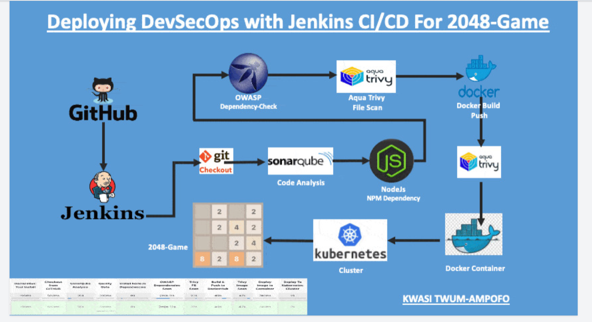
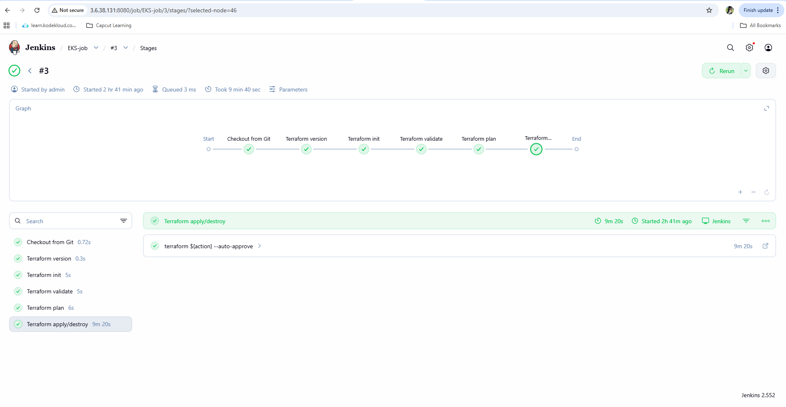
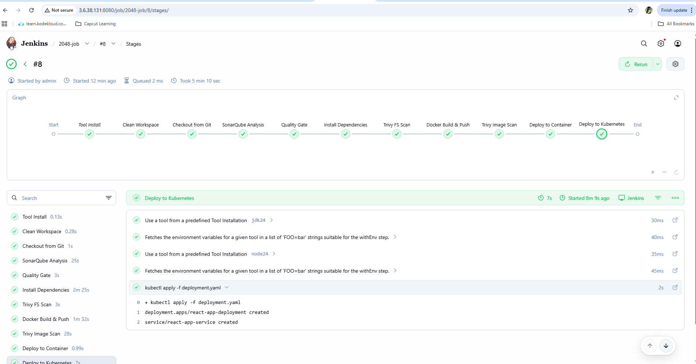
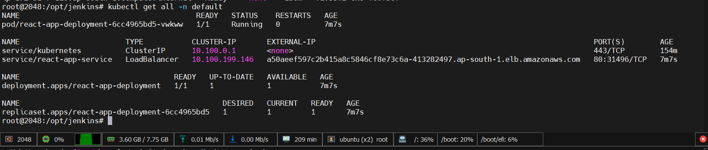
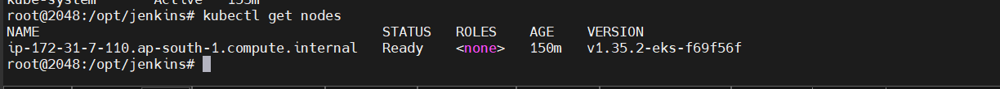
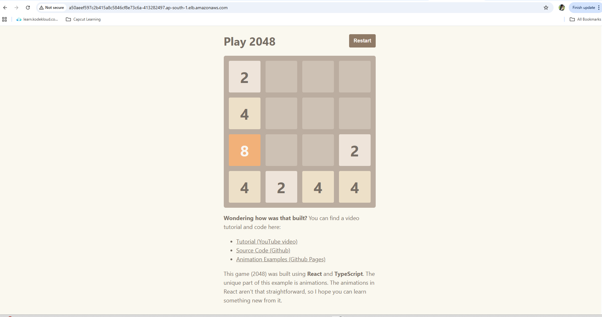

# 🚀 DevSecOps CI/CD Pipeline for 2048 Game using Jenkins, AWS EKS & Security Tools


## 📌 Project Overview

This project demonstrates a **complete DevSecOps pipeline** for deploying the **2048 Game application** using:

* CI/CD with **Jenkins**
* Infrastructure provisioning using **Terraform**
* Containerization with **Docker**
* Security scanning using:

  * **OWASP Dependency Check**
  * **Trivy**
  * **Docker Scout**
* Code quality analysis using **SonarQube**
* Deployment on **AWS EKS (Kubernetes)**

---

## 🏗️ Architecture Flow

<h3 align="left">architecture</h3>
<p align="left">
  
</p>

```
GitHub → Jenkins → SonarQube → OWASP → Trivy → Docker → EKS (Kubernetes)
```

---

# ⚙️ Step 1: AWS EC2 Setup

* Launch EC2 instance:

  * **AMI**: Ubuntu 24
  * **Instance Type**: t2.large
  * **Storage**: 50GB
* Attach IAM Role:

  * Administrator Access

---

# 🛠️ Step 2: Install Required Tools

### Install:

* Docker
* Jenkins (WAR setup)
* Java 21
* SonarQube (Docker)
* AWS CLI
* Kubectl
* Terraform
* Trivy

---

## 🔧 Script 1: Jenkins + Java + Docker Setup

```bash
#!/bin/bash
set -e

sudo apt update -y
sudo apt install -y openjdk-21-jdk wget curl

# Jenkins Setup
sudo mkdir -p /opt/jenkins
cd /opt/jenkins
wget https://get.jenkins.io/war/2.552/jenkins.war

nohup java -jar /opt/jenkins/jenkins.war > jenkins.log 2>&1 &

# Docker Install
sudo apt-get install ca-certificates curl gnupg -y
sudo install -m 0755 -d /etc/apt/keyrings

curl -fsSL https://download.docker.com/linux/ubuntu/gpg | sudo gpg --dearmor -o /etc/apt/keyrings/docker.gpg

echo "deb [arch=$(dpkg --print-architecture)] https://download.docker.com/linux/ubuntu stable" | sudo tee /etc/apt/sources.list.d/docker.list

sudo apt update
sudo apt install docker-ce docker-ce-cli containerd.io -y

sudo usermod -aG docker ubuntu
```

---

## 🔧 Script 2: Terraform + Kubectl + AWS CLI

```bash
#!/bin/bash

# Terraform
wget -O- https://apt.releases.hashicorp.com/gpg | sudo gpg --dearmor -o /usr/share/keyrings/hashicorp.gpg
sudo apt update && sudo apt install terraform -y

# Kubectl
curl -LO https://dl.k8s.io/release/stable.txt
sudo install kubectl /usr/local/bin/

# AWS CLI
curl "https://awscli.amazonaws.com/awscli-exe-linux-x86_64.zip" -o awscliv2.zip
unzip awscliv2.zip
sudo ./aws/install
```

---

## 🔐 Install Trivy

```bash
sudo apt install wget apt-transport-https gnupg -y
wget -qO - https://aquasecurity.github.io/trivy-repo/deb/public.key | sudo tee /etc/apt/trusted.gpg.d/trivy.asc

sudo apt update
sudo apt install trivy -y
```

---

## 📊 SonarQube Setup

```bash
docker run -d --name sonar -p 9000:9000 sonarqube:lts-community
```

* URL: `http://<IP>:9000`
* Default:

  * Username: `admin`
  * Password: `admin`

---

# 🔁 Step 3: Jenkins Pipeline Setup

---

## 🧱 Job 1: EKS Provision using Terraform

### Features:

* Parameterized pipeline (`apply / destroy`)
* Uses S3 backend
* Creates EKS cluster

```groovy
pipeline{
    agent any
    parameters {
        choice(name: 'action', choices: ['apply', 'destroy'])
    }
    stages {
        stage('Checkout'){
            steps{
                git branch: 'main', url: 'https://github.com/Divyasri-div/devsecops-2048.git'
            }
        }
        stage('Terraform Init'){
            steps{
                dir('EKS_TERRAFORM'){
                    sh 'terraform init'
                }
            }
        }
        stage('Terraform Apply/Destroy'){
            steps{
                dir('EKS_TERRAFORM'){
                    sh "terraform ${action} --auto-approve"
                }
            }
        }
    }
}
```

<h3 align="left">EKS-job</h3>
<p align="left">
  
</p>

---

## 🎮 Job 2: Application Deployment Pipeline

### 🔹 Pipeline Stages:

1. Checkout Code
2. SonarQube Analysis
3. Quality Gate
4. npm install
5. OWASP Scan
6. Trivy FS Scan
7. Docker Build & Push
8. Trivy Image Scan
9. Deploy to Docker
10. Deploy to Kubernetes

---

## 🚀 Jenkins Pipeline Script

```groovy
pipeline{
    agent any
    tools{
        jdk 'jdk24'
        nodejs 'node24'
    }
    environment {
        SCANNER_HOME=tool 'sonar-scanner'
    }
    stages {

        stage('Clean'){
            steps{ cleanWs() }
        }

        stage('Checkout'){
            steps{
                git branch: 'main', url: 'https://github.com/Divyasri-div/devsecops-2048.git'
            }
        }

        stage('SonarQube'){
            steps{
                withSonarQubeEnv('sonar-server'){
                    sh '''
                    $SCANNER_HOME/bin/sonar-scanner \
                    -Dsonar.projectName=Game \
                    -Dsonar.projectKey=Game
                    '''
                }
            }
        }

        stage('Quality Gate'){
            steps{
                waitForQualityGate abortPipeline: false
            }
        }

        stage('Install Dependencies'){
            steps{
                sh 'npm install'
            }
        }

        stage('Trivy FS Scan'){
            steps{
                sh 'trivy fs . > trivyfs.txt'
            }
        }

        stage('Docker Build & Push'){
            steps{
                withDockerRegistry(credentialsId: 'docker'){
                    sh '''
                    docker build -t 2048 .
                    docker tag 2048 divyasri52/2048:latest
                    docker push divyasri52/2048:latest
                    '''
                }
            }
        }

        stage('Trivy Image Scan'){
            steps{
                sh 'trivy image divyasri52/2048:latest > trivy.txt'
            }
        }

        stage('Deploy to Kubernetes'){
            steps{
                withKubeConfig(credentialsId: 'k8s'){
                    sh 'kubectl apply -f deployment.yaml'
                }
            }
        }
    }
}
```

<h3 align="left">2048-job</h3>
<p align="left">
  
</p>

---

# ☸️ Kubernetes Deployment

```bash
kubectl apply -f deployment.yaml
kubectl get pods
kubectl get svc
```

<h3 align="left">services</h3>
<p align="left">
  
</p>

<h3 align="left">nodes</h3>
<p align="left">
  
</p>

<h3 align="left">app-deployed</h3>
<p align="left">
  
</p>
---

# 🔐 Security Tools Used

* ✅ SonarQube → Code Quality
* ✅ OWASP Dependency Check → Vulnerability Detection
* ✅ Trivy → Filesystem & Image Scan
* ✅ Docker Scout → Container Security

---

# 🐳 Docker Hub

Image:

```
divyasri52/2048:latest
```

---

# ❗ Troubleshooting

### Docker Issue Fix

```bash
systemctl edit docker.service
```

Add:

```
[Service]
Environment=DOCKER_MIN_API_VERSION=1.24
```

```bash
systemctl restart docker
```

---

### SonarQube Restart

```bash
docker start sonar
```

---

### EKS LoadBalancer Issue

* Update **EKS Security Group**
* Allow:

  * All traffic OR required ports

---

# 📌 Final Output

* 🎮 2048 Game deployed on Kubernetes
* 🔐 Fully secured CI/CD pipeline
* ⚙️ Automated infrastructure provisioning
* 📊 Continuous code quality monitoring

