# AWS Cloud-Native E-Commerce Application

A hands-on AWS cloud project deploying a microservices-based e-commerce application with managed AWS infrastructure, containerized backend services, API integration, database services, and monitoring.

## Project Overview

This project demonstrates how an e-commerce application can be deployed on AWS using cloud-native services. The application separates its frontend and backend into independent components and connects the backend through API Gateway and internal AWS networking.

**Project type:** Personal hands-on cloud deployment project  
**Focus areas:** AWS Cloud, DevOps, Microservices, Containerization, Networking, Troubleshooting

## Architecture

<h3 align="left">ecommerce-architecture</h3>
<p align="left">
  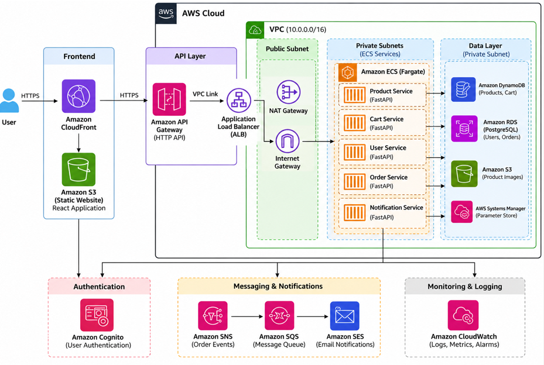
</p>


### Architecture Components

| Layer | AWS services / technology | Purpose |
|---|---|---|
| Frontend | React, Amazon S3, CloudFront | Hosts and delivers the web application |
| API access | Amazon API Gateway HTTP API, VPC Link, ALB | Routes frontend requests to backend services |
| Compute | Amazon ECS, AWS Fargate | Runs containerized microservices |
| Container registry | Amazon ECR | Stores application container images |
| Authentication | Amazon Cognito | Supports user authentication |
| Database | Amazon DynamoDB, Amazon RDS for PostgreSQL | Stores application and transactional data |
| Networking | Amazon VPC, subnets, security groups | Provides network isolation and controlled connectivity |
| Messaging | Amazon SNS, Amazon SQS, Amazon SES | Supports asynchronous notification workflows |
| Monitoring | Amazon CloudWatch | Provides application logs and monitoring |
| Configuration and access | AWS Systems Manager, IAM | Supports configuration management and access control |


## Microservices

The application repository contains the following backend services:

- **Product Service:** Manages product catalog operations.
- **Cart Service:** Handles shopping cart operations.
- **User Service:** Manages user profile operations.
- **Order Service:** Handles order processing and coordinates related operations.
- **Notification Service:** Supports asynchronous email notifications, where configured.

The backend services are implemented using Python and FastAPI. The frontend uses React.

## Request Flow

1. A user opens the e-commerce application in a browser.
2. CloudFront delivers the frontend assets hosted in Amazon S3.
3. The frontend sends API requests to API Gateway.
4. API Gateway forwards supported requests through the configured VPC Link and load balancer.
5. The relevant backend microservice processes the request.
6. The service interacts with its configured database or dependent services.
7. The response is returned to the frontend.
8. Where configured, asynchronous messaging services handle notification workflows.

## Deployment Overview

The application was deployed in stages:

1. Set up AWS networking and security configuration.
2. Configure user authentication with Amazon Cognito.
3. Deploy frontend infrastructure using S3 and CloudFront.
4. Configure the required database services.
5. Build container images and push them to Amazon ECR.
6. Deploy backend microservices on Amazon ECS with AWS Fargate.
7. Configure the Application Load Balancer and API Gateway integration.
8. Connect the frontend to the backend APIs.
9. Configure messaging, monitoring, and other supporting services as implemented.
10. Validate the application and clean up resources that are no longer required.

## Step-by-Step Implementation

###1. PREREQUISITES
----------------

1.1 AWS ACCOUNT

- An AWS account with the required administrative permissions.
- AWS CLI configured with AWS Access Key ID and Secret Access Key.


1.2 LOCAL WORKSTATION (LINUX / MAC / WINDOWS)

- A Linux or macOS machine to run the deployment steps.
- Windows users can use WSL2 (Ubuntu).

1.3 REQUIRED TOOLS

- Git           - Version control
- Docker        - Container runtime for building and pushing images
- Node.js 20+   - JavaScript runtime for building the React frontend
- npm           - Node.js package manager
- AWS CLI v2    - Command-line interface for AWS services


2. STEP 1: CLONE THE REPOSITORY
-------------------------------

Clone the project repository to your local machine.

Command:

git clone https://github.com/awswithchetan/ecommerce-web-app.git

Navigate to the project directory:

cd ecommerce-web-app


3. STEP 2: INSTALL REQUIRED TOOLS
---------------------------------

If the required tools are not installed, run the project's prerequisite installation script.

Command:

bash install-prerequisites.sh

NOTE:
Run this command from the project directory.
Review the script before executing it and ensure it supports your operating system.


4. STEP 3: VERIFY TOOL INSTALLATION
-----------------------------------

Run the following commands to verify that the required tools are installed.

Check AWS CLI:

```
aws --version
```
Check Docker:
```
docker --version
```
Check Node.js:
```
node --version
```
Check npm:
```
npm --version
```
Check Git:
```
git --version
```

5. STEP 4: CONFIGURE AND VERIFY AWS CLI ACCESS
----------------------------------------------

5.1 CREATE AWS ACCESS KEYS

If AWS CLI is not configured, follow these steps:

1. Sign in to the AWS Management Console.
2. Open IAM.
3. Select your IAM user.
4. Open Security credentials.
5. Create an access key if your organization's security policy permits it.
6. Store the credentials securely.

Prefer temporary credentials or an approved IAM Identity Center setup when available.


5.2 CONFIGURE AWS CLI

Run:
```
aws configure
```
Enter the requested information:

AWS Access Key ID:     <YOUR-ACCESS-KEY-ID>
AWS Secret Access Key: <YOUR-SECRET-ACCESS-KEY>
Default region name:   ap-south-1
Default output format: json

Replace the placeholders with your actual credentials.


5.3 VERIFY AWS CLI ACCESS

Run:
```
aws sts get-caller-identity
```
Expected output format:

{
    "UserId": "EXAMPLE-USER-ID",
    "Account": "123456789012",
    "Arn": "arn:aws:iam::123456789012:user/your-user"
}


6. STEP 5: SET THE DEFAULT AWS REGION
-------------------------------------

Set the default AWS region to Mumbai (ap-south-1).

For Linux, macOS, or WSL Ubuntu, run:

export AWS_DEFAULT_REGION=ap-south-1

Verify the region:

echo $AWS_DEFAULT_REGION

Expected output:

ap-south-1

NOTE:
The export command applies to the current shell session. To configure a persistent default, use the AWS CLI configuration file or your shell profile.

You can also specify the region explicitly in AWS CLI commands:

aws sts get-caller-identity --region ap-south-1


7. PREREQUISITES CHECKLIST
--------------------------

- AWS account created
- Required AWS permissions available
- Linux, macOS, or WSL Ubuntu environment ready
- Git installed and verified
- Docker installed and running
- Node.js 20+ installed
- npm installed
- AWS CLI v2 installed
- Project repository cloned
- AWS CLI credentials configured securely
- AWS identity verified successfully
- Default AWS region configured

### 2. Networking Foundation

**AWS Services:** Amazon VPC, Subnets, Internet Gateway, NAT Gateway, Route Tables, Security Groups

- Created a VPC to provide an isolated network for the application.
- Configured public and private subnets across Availability Zones.
- Set up route tables and internet connectivity according to the network design.
- Configured security groups to control communication between application components.
- Prepared private subnets for backend services and database resources.

ecommerce-vpc (10.10.0.0/16)
- Public Subnets (Internet Gateway)
    - ecommerce-public-subnet-1 (10.10.0.0/24) - ap-south-1a
    - ecommerce-public-subnet-2 (10.10.1.0/24) - ap-south-1b
- Private ECS Subnets (NAT Gateway)
    - ecommerce-private-ecs-1 (10.10.10.0/24) - ap-south-1a
    - ecommerce-private-ecs-2 (10.10.11.0/24) - ap-south-1b
- Private Database Subnets (NAT Gateway)
    - ecommerce-private-database-1 (10.10.20.0/24) - ap-south-1a
    - ecommerce-private-database-2 (10.10.21.0/24) - ap-south-1b
	
<h3 align="left">ecommerce-vpc</h3>
<p align="left">
  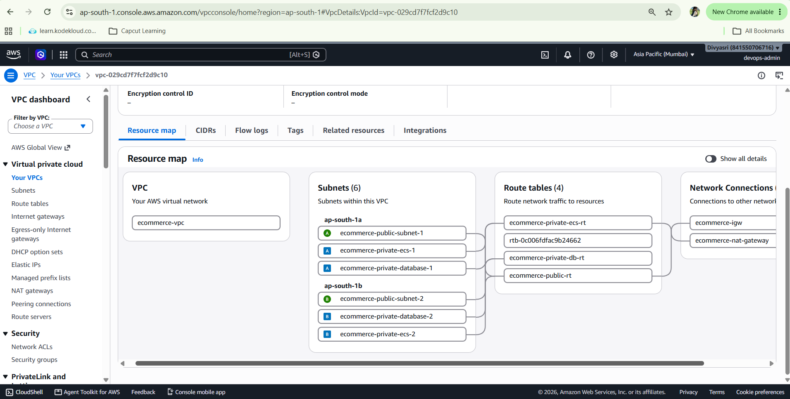
</p>

### 2. Authentication

**AWS Service:** Amazon Cognito

- Configured a Cognito User Pool for user authentication.
- Set up the application client and authentication configuration.
- Integrated authentication with the frontend and API where required.

create user pool

1.Go to AWS Cognito Console → User pools → Create user pool

2.Define your application: Select Single-page application (SPA)

3.Name your application: Enter ecommerce-app (or your preferred name)

Configure options:

Options for sign-in identifiers: Select Email
Self-registration: Enable
Required attributes for sign-up: Select email and name
Click Create user directory

<h3 align="left">ecommerce-userpool</h3>
<p align="left">
  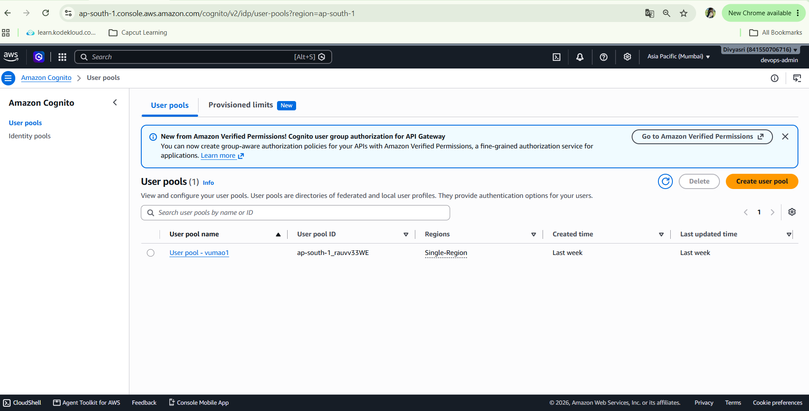
</p>

#Configure Cognito User Pool App Client

- Go to your newly created User Pool → App integration tab → App clients
- Click on your app client name and Edit
Under Authentication flows, enable:
ALLOW_USER_PASSWORD_AUTH
ALLOW_USER_SRP_AUTH
ALLOW_REFRESH_TOKEN_AUTH

<h3 align="left">ecommerce-appclient</h3>
<p align="left">
  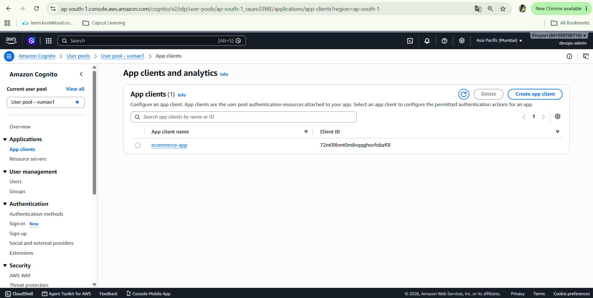
</p>


### 3. Frontend Infrastructure

**AWS Services:** Amazon S3, Amazon CloudFront

- Prepared Amazon S3 for hosting frontend assets.
- Configured CloudFront to deliver the application to users.
- Enabled HTTPS delivery through the configured distribution.
- Verified that the frontend was accessible through its deployment URL.

<h3 align="left">ecommerce-s3</h3>
<p align="left">
  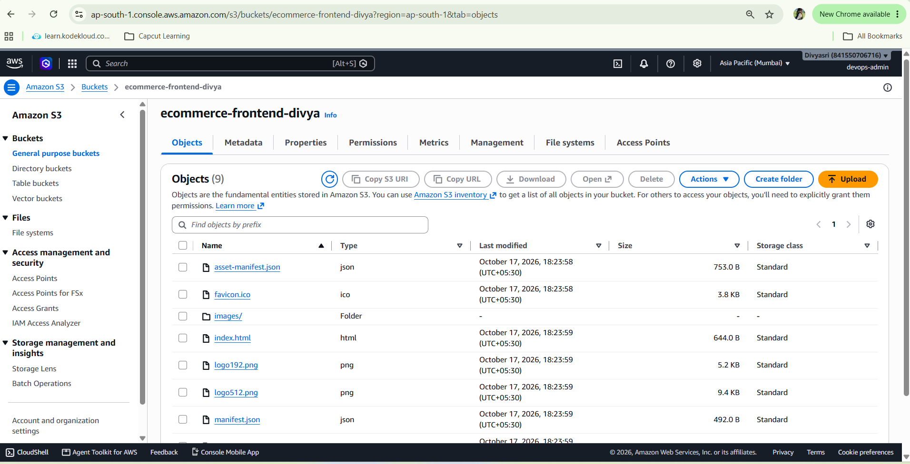
</p>


<h3 align="left">ecommerce-cloudfront</h3>
<p align="left">
  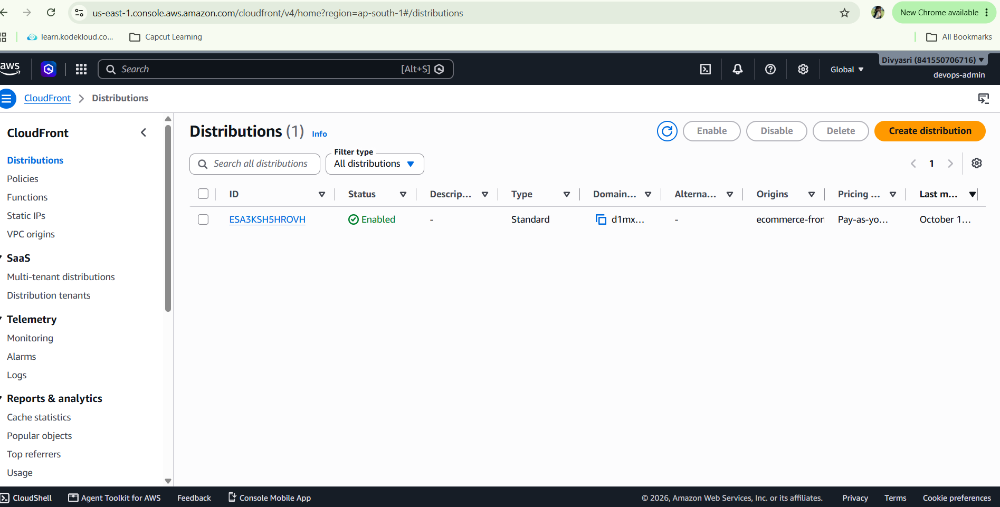
</p>


### 4. Data Layer

**AWS Services:** Amazon DynamoDB, Amazon RDS for PostgreSQL, Amazon S3, AWS Systems Manager Parameter Store

- Configured DynamoDB tables for product catalogue and shopping cart data.
- Set up PostgreSQL on Amazon RDS for user and order data.
- Used Amazon S3 to store product images.
- Configured application parameters for database connectivity and service configuration.
- Restricted database access through the appropriate network and security settings.

<h3 align="left">ecommerce-dynamodb</h3>
<p align="left">
  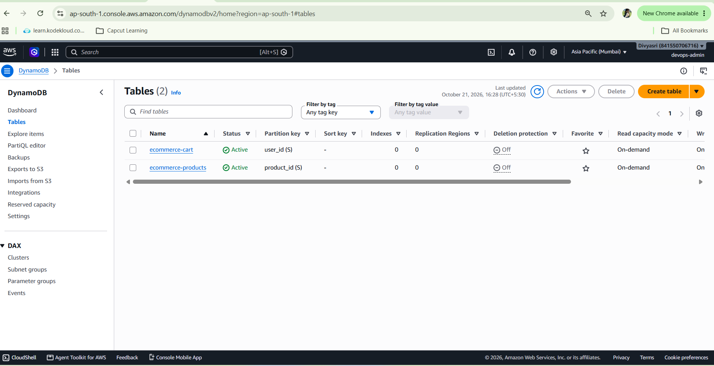
</p>


<h3 align="left">ecommerce-rds</h3>
<p align="left">
  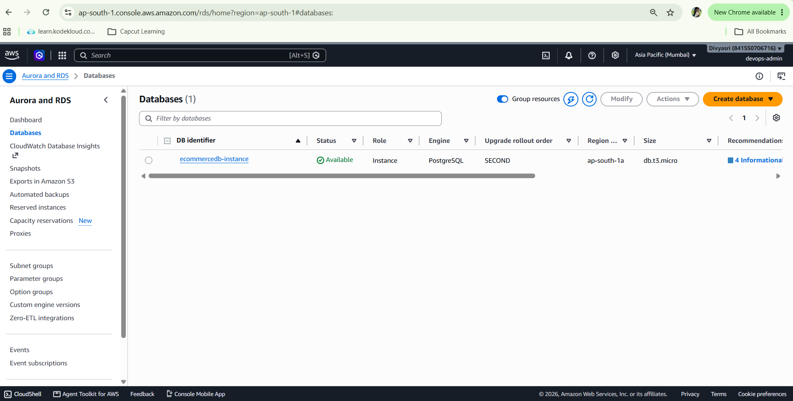
</p>


### 5. Containerization and Backend Deployment

**AWS Services:** Docker, Amazon ECR, Amazon ECS, AWS Fargate, Application Load Balancer

- Built Docker images for the backend microservices.
- Published container images to Amazon ECR.
- Configured ECS task definitions and services to run the containers on Fargate.
- Set up load balancing to route requests to the appropriate backend services.
- Configured service ports, health checks, networking, and application logs.

<h3 align="left">ecommerce-ecr</h3>
<p align="left">
  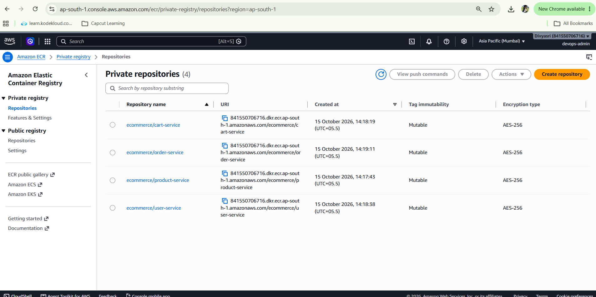
</p>

<h3 align="left">ecommerce-ecs-services</h3>
<p align="left">
  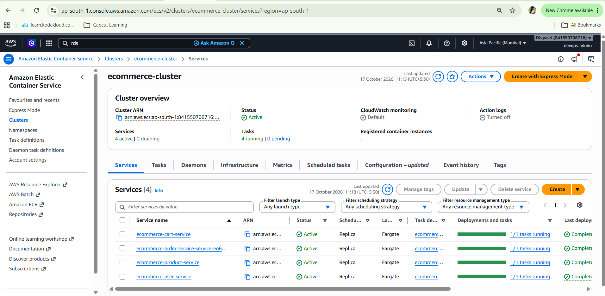
</p>

<h3 align="left">ecommerce-alb</h3>
<p align="left">
  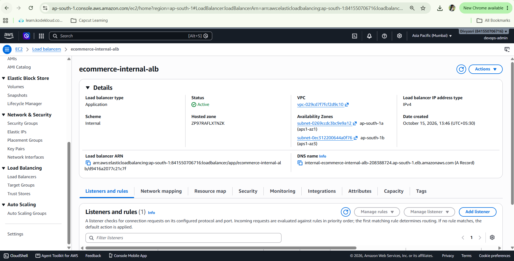
</p>

<h3 align="left">ecommerce-tg</h3>
<p align="left">
  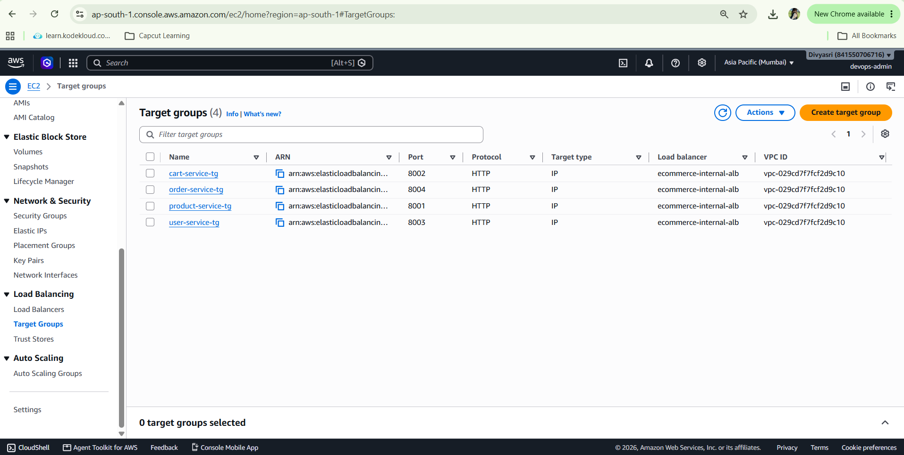
</p>

<h3 align="left">ecommerce-taskdefinitions</h3>
<p align="left">
  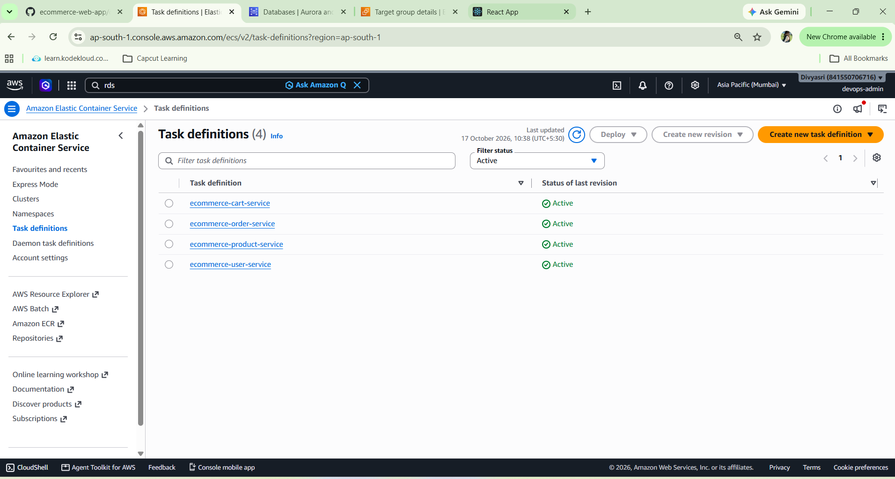
</p>

### 6. API Gateway Configuration

**AWS Services:** Amazon API Gateway, VPC Link, Application Load Balancer

- Configured API Gateway to provide a unified entry point for backend requests.
- Set up API routes and HTTP methods for application operations.
- Connected API Gateway to the backend through the configured integration.
- Configured VPC Link for private backend connectivity where applicable.
- Tested API requests and investigated integration errors.

<h3 align="left">ecommerce-api</h3>
<p align="left">
  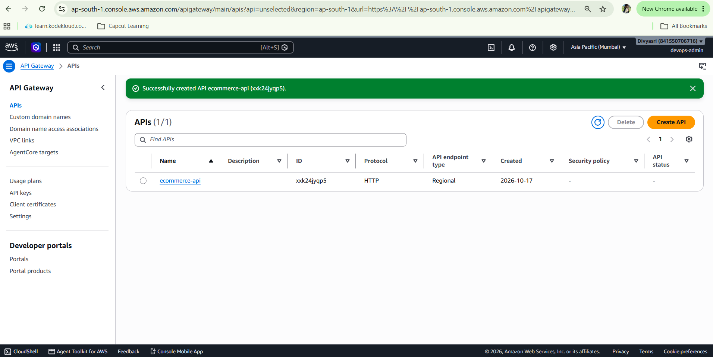
</p>


<h3 align="left">ecommerce-api-created</h3>
<p align="left">
  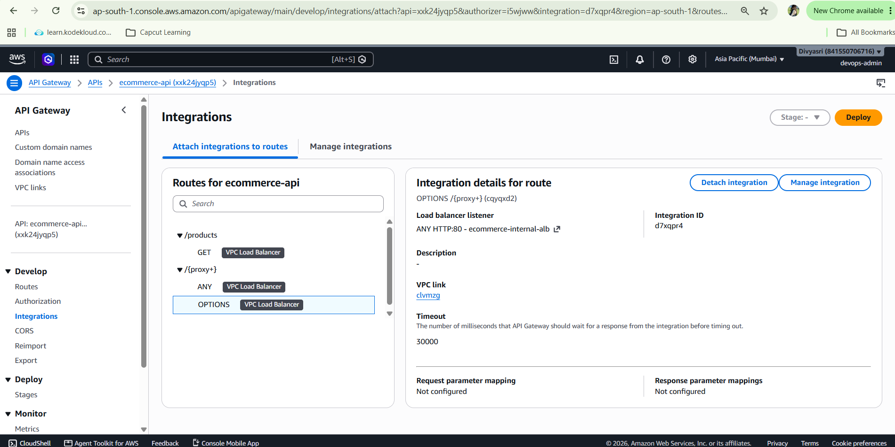
</p>

<h3 align="left">ecommerce-vpclink</h3>
<p align="left">
  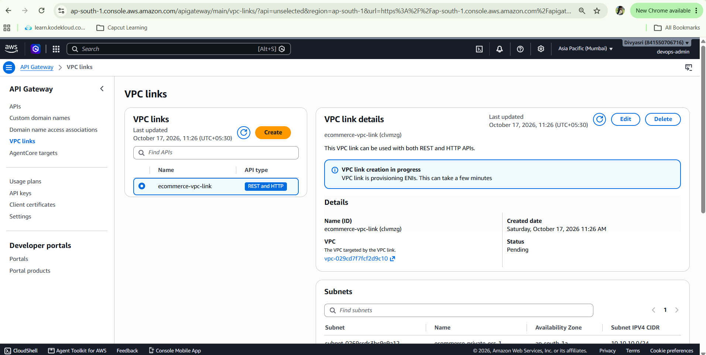
</p>

<h3 align="left">ecommerce-vpclink-sg</h3>
<p align="left">
  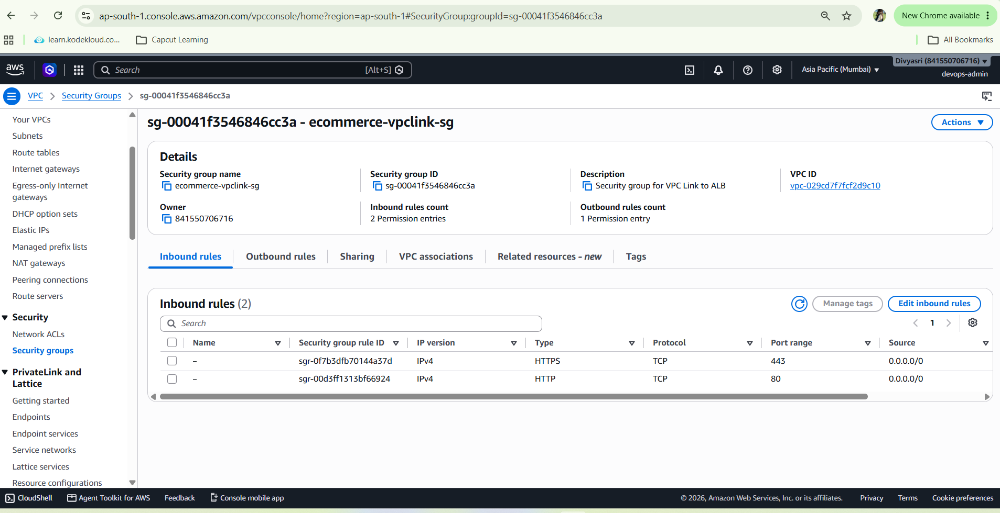
</p>


### 7. Frontend and Backend Integration

- Updated the frontend API configuration to use the deployed API Gateway endpoint.
- Rebuilt the React application after updating the configuration.
- Published the updated frontend assets to Amazon S3.
- Refreshed CloudFront content where required.
- Tested communication between the frontend and backend services.

### 8. Event-Driven Processing

**AWS Services:** Amazon SNS, Amazon SQS, Amazon SES

- Configured messaging components for asynchronous order events and notifications, where implemented.
- Set up the required subscriptions and permissions.
- Tested message delivery and notification processing.

<h3 align="left">ecommerce-SNS</h3>
<p align="left">
  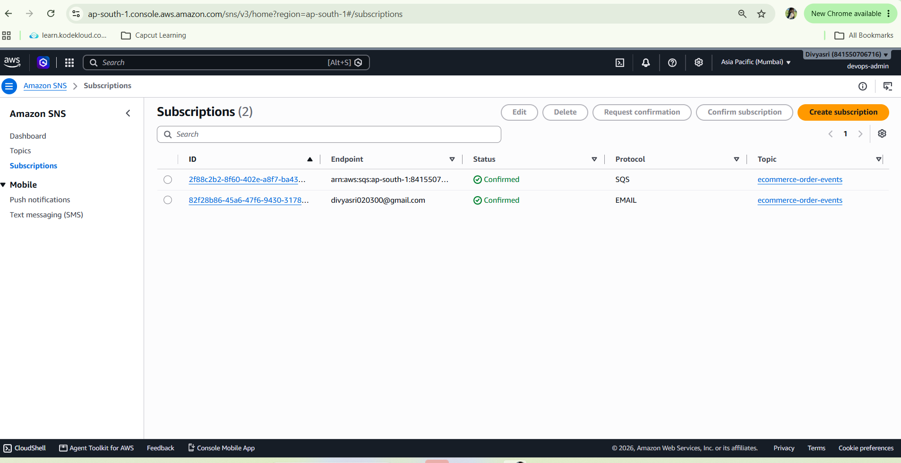
</p>


<h3 align="left">ecommerce-sqs</h3>
<p align="left">
  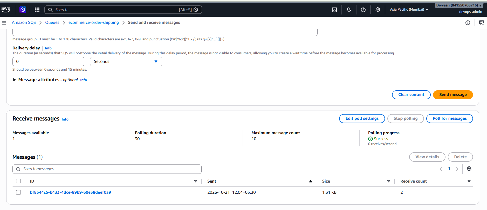
</p>

<h3 align="left">ecommerce-ses</h3>
<p align="left">
  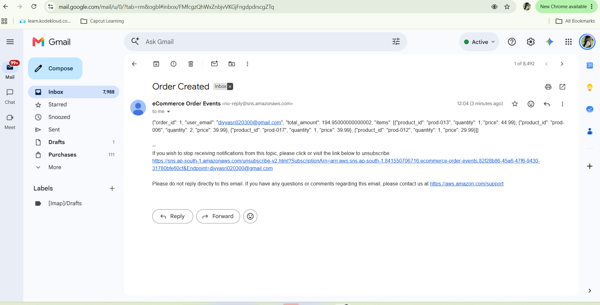
</p>


### 9. Testing and Troubleshooting

- Tested frontend access and backend API operations.
- Verified product, cart, and order workflows where implemented.
- Investigated an inventory-service integration error caused by a missing HTTP/HTTPS URL protocol.
- Corrected the service URL configuration and retested the affected request.
- Reviewed application logs and service health to validate the results.

### 10. Monitoring, Security and Cost Management

**AWS Services:** Amazon CloudWatch, AWS IAM

- Reviewed application logs and service status.
- Applied appropriate IAM permissions and security group rules.
- Avoided exposing credentials and sensitive configuration.
- Reviewed AWS resources and costs.
- Removed resources that were no longer required, where applicable.

<h3 align="left">ecommerce-iam</h3>
<p align="left">
  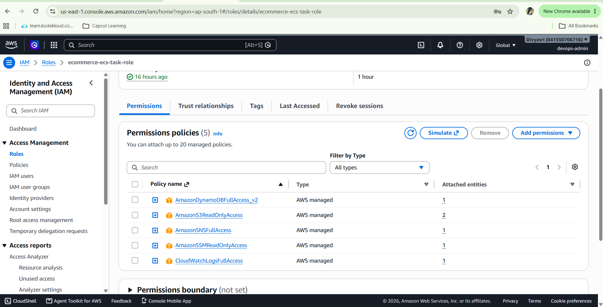
</p>


## Testing and Validation

Testing was performed to verify application connectivity and backend request processing.

- Verified that the frontend could access the configured backend APIs.
- Tested order-related API requests.
- Troubleshot an inventory-service integration failure caused by a missing HTTP/HTTPS URL protocol.
- Corrected the service URL configuration and redeployed the order service.
- Verified the corrected application flow.

<h3 align="left">ecommerce-app</h3>
<p align="left">
  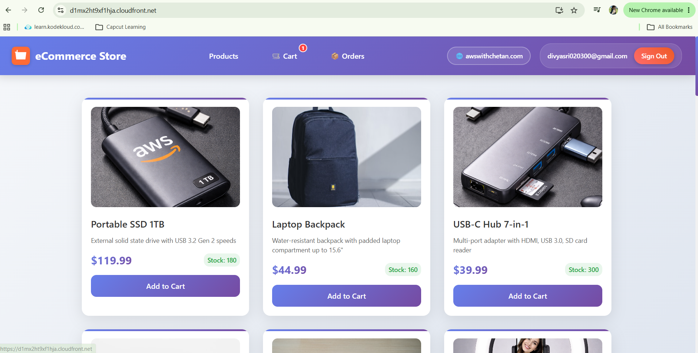
</p>


## Key Learnings

- Deploying containerized microservices on AWS.
- Configuring API Gateway and private backend connectivity.
- Working with VPC networking, load balancing, and security groups.
- Integrating managed database services with backend applications.
- Troubleshooting service-to-service communication.
- Validating API responses and application workflows.
- Monitoring application behavior using CloudWatch.
- Managing AWS resource costs and cleanup.

## Security and Cost Considerations

- Never commit AWS credentials, secret keys, passwords, access tokens, or `.env` files.
- Use IAM permissions and security groups appropriate to each component.
- Avoid exposing private database endpoints or sensitive configuration.
- Review active AWS resources and delete resources that are no longer needed to reduce ongoing charges.

