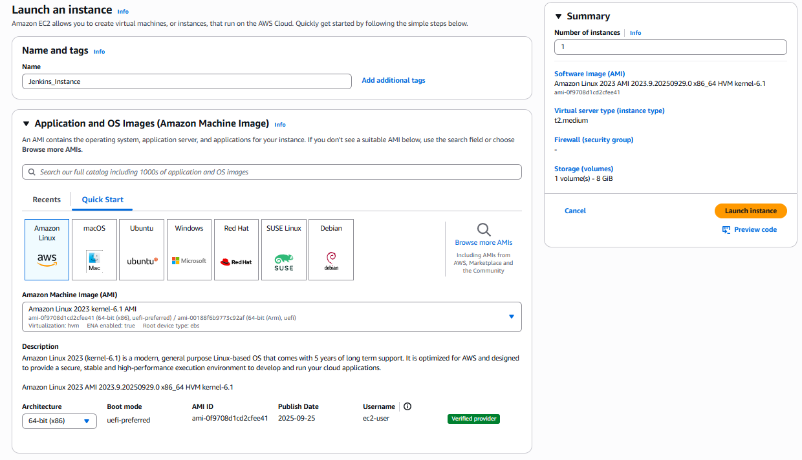

# Jenkins Installation and Configuration on AWS EC2 (Amazon Linux 2)

This repository documents my hands-on setup of **Jenkins** on an **Amazon Linux 2 EC2 instance** as part of my DevOps learning journey.  
This documentation provides a detailed step-by-step guide to installing and configuring **Jenkins** on an **AWS EC2** instance running **Amazon Linux 2**.  
Jenkins is an open-source automation server widely used for building CI/CD pipelines and automating software development workflows.

---

## 🧠 Project Overview

This project demonstrates how to:
- Launch an EC2 instance on AWS
- Install and configure **Java 17 (Amazon Corretto)**
- Install and run **Jenkins** as a service
- Access Jenkins from the public IP
- Secure and manage Jenkins for CI/CD pipelines

---

## ☁️ 1. Launch EC2 Instance

### EC2 Configuration:
- **AMI:** Amazon Linux 2 (Free Tier eligible)
- **Instance Type:** t2.medium
- **Key Pair:** Existing or newly created `.pem` key
- **Storage:** Default (8 GB or more)
- **Security Group Inbound Rules:**
  | Type | Protocol | Port | Source |
  |------|-----------|------|---------|
  | SSH | TCP | 22 | My IP |
  | HTTP | TCP | 80 | Anywhere |
  | Custom TCP | TCP | 8080 | Anywhere |

> Port 8080 is required for Jenkins UI access.

<h3 align="left">ec2-setup</h3>

  

<h3 align="left">ec2-setupp</h3>

  

<h3 align="left">Security Group Rules</h3>
<table align="left" style="border:100px solid black; border-collapse: collapse;">
  <tr>
    <td>
      
    </td>
  </tr>
</table>

